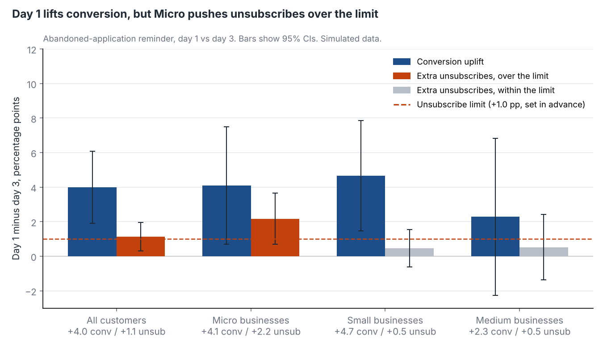
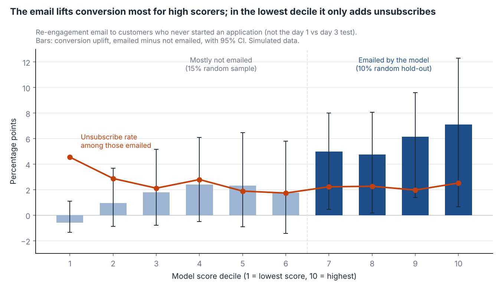

# Contact Strategy Experiment Review

A split-test and model review for a simulated SME lender. It asks when to send an abandoned-application reminder (day 1 or day 3), whether the extra conversions are worth the extra unsubscribes, and where a model-driven email helps or hurts.

> **About the data:** all data is simulated for a fictional lender. Nothing here describes any real company. The data was generated with a **known effect built in** (see [`data/generate_data.py`](data/generate_data.py)), so the analysis can be checked against the truth, including where noise could have misled it.

## The problem
Contacting customers at the right moment wins business, but contacting them too soon or too often costs goodwill and can bring in weaker customers. A lender needs to know whether a faster reminder is worth it overall, and whether the answer differs by type of business.

**Read the one-page decision memo: [memo to the Head of Operations](report/memo_head_of_operations.md).**

## Verdict
**Keep the reminder at day 3 for now.** Day 1 lifts conversion by 4 points, but it pushed unsubscribes past the limit set before the test, driven by Micro businesses (4.3% vs 2.2%). Re-test day 1 for Small and Medium businesses only, over 6 months. A test large enough to settle the value question would take about 3 years at current volumes, so value should be judged on a faster signal, such as the first two repayments.



## Method
1. **Pre-registered before analysis:** hypothesis, decision metric, guardrails, decision rule, sample size and a sensitivity check. See [pre_registration.md](report/pre_registration.md).
2. **Cleaned:** each customer's first abandonment only; duplicate sends removed; reminders with no recorded arm excluded; missing loan values reported by arm.
3. **Randomisation checked:** a sample-ratio mismatch test found no problem (p = 0.89).
4. **Conversion:** two-proportion z-test with 95% confidence intervals.
5. **Value per customer:** loan margin if repaid on time, a blended late-payment and default cost if not, minus £40 per unsubscribe or £100 per complaint (not both). Tested for **non-inferiority** with a bootstrap 95% CI and a −£50 margin.
6. **Segments:** Micro, Small and Medium only, chosen in advance, with a Bonferroni correction.
7. **Sensitivity:** each value assumption at 0.5× and 2×. The verdict didn't change in any of the 8 runs, because it is driven by the unsubscribe guardrail.

## Findings

| | Conversion (day 1 − day 3) | Unsubscribes | Value per customer | Value check |
| --- | --- | --- | --- | --- |
| **All customers** | **+4.0 pp** [+1.9, +6.1], p < 0.001 | **+1.1 pp** (limit +1.0) | +£14 [−£56, +£84] | Inconclusive |
| Micro | +4.1 pp, p = 0.018 | **+2.2 pp** | **−£51** [−£93, −£10] | **Fail** |
| Small | +4.7 pp, p = 0.004 | +0.5 pp | +£62 [−£27, +£151] | Pass |
| Medium | +2.3 pp, p = 0.33 | +0.5 pp | +£58 [−£236, +£349] | Inconclusive |

*Segment significance uses a corrected threshold of p < 0.017.*

- Day 1 clearly converts more customers overall.
- It breaches the unsubscribe guardrail overall, so the pre-registered verdict is to keep day 3.
- The damage is concentrated in Micro businesses, where day 1 also fails the value check.
- Small looks good on every measure, but that is an after-the-fact observation, so it needs its own test.

## Model check: the re-engagement email

*A different email to different customers: a nudge to people who signed up but never started an application. It is not part of the day 1 vs day 3 test.*



| Policy | Emails | Extra conversions per 1,000 emails | Unsubscribes per 1,000 emails |
| --- | --- | --- | --- |
| Email everyone | 11,902 | 31.6 | 24.9 |
| Model's choice (top 40%) | 4,760 | 57.4 | 22.4 |

- **The model's targeting works:** among the top 40% of scores, the email lifts conversion by 5.8 points [3.4, 7.8].
- **Don't extend the email to the lowest-scoring 10%:** among the random sample that was emailed, there was no gain in conversion, and 4.6% unsubscribed.
- **Deciles 3–6 may be worth emailing,** with a pooled lift of about 2 points [0.5, 3.8]. This is **directional, not proven**, because of small samples; the next step is a randomised test of emailing them.

**Questions for data science**
1. Does the model predict who will convert, or who will convert *because of* the email? Targeting customers who would convert anyway wastes contacts.
2. The model mostly sees outcomes for people it chose to email. Are the 10% holdout and 15% random sample enough to retrain it fairly, and does it count the cost of unsubscribes?

## Where this could mislead
- **Peeking and stopping early.** Checking results repeatedly and stopping at the first significant moment inflates false positives. This analysis ran once, at the planned sample size.
- **Novelty effects.** A new email timing can perform differently at first than it does once customers get used to it. A live rollout should keep a holdout to watch for this.
- **Multiple comparisons.** Checking three segments raises the chance of a fluke "win", so segment claims use a stricter threshold, and the Small and Medium result is treated as a lead.
- **Model selection bias.** The model learns mostly from people it emails, so its view of everyone else is thin and its estimates for the highest scorers rest on small holdouts.
- **Slow outcomes.** Repayment takes months in reality. A live test would need an early proxy, such as the first two repayments.
- **Assumption-driven value.** Margins and costs are illustrative. The sensitivity check shows the verdict holds when each is halved or doubled.

## SQL queries

| # | Business question | Query |
| --- | --- | --- |
| 01 | Who is in the split test, once cleaned? | [sql](sql/01_test_population.sql) |
| 02 | Did randomisation work? | [sql](sql/02_sample_ratio_check.sql) |
| 03 | How did conversion and the guardrails compare, overall and by segment? | [sql](sql/03_conversion_and_guardrails.sql) |
| 04 | Are missing loan values balanced across arms? | [sql](sql/04_missing_loan_values.sql) |
| 05 | Which score decile is each re-engagement customer in, and were they emailed? | [sql](sql/05_score_deciles.sql) |
| 06 | Does the email help in each decile? | [sql](sql/06_decile_uplift.sql) |
| 07 | How much of each decile does the model email? | [sql](sql/07_who_gets_emailed.sql) |
| 08 | How does targeting compare with emailing everyone? | [sql](sql/08_targeting_policies.sql) |

## How to reproduce
```bash
pip3 install numpy matplotlib
python3 data/generate_data.py          # builds data/lender.db (fixed seed)
python3 analysis/analyse_test.py       # split test, value check, sensitivity
python3 analysis/split_test_chart.py   # headline chart
python3 analysis/model_check_chart.py  # model decile chart
```

## How this was built
I set the questions, the pre-registration and the decision rules, and made the calls on the findings. I used Claude Code (an AI assistant) to help write and check the Python and SQL and to draft the write-up, which I reviewed and edited. This is a portfolio project, not commercial testing experience.

## About me
Gana Cariappa: analyst with a sports science background, based in London. I've built data models, benchmarks and reporting for multi-stakeholder programmes, including at the Premier League. MSc Human and Applied Physiology, King's College London. [LinkedIn](https://www.linkedin.com/in/gana-cariappa/)
